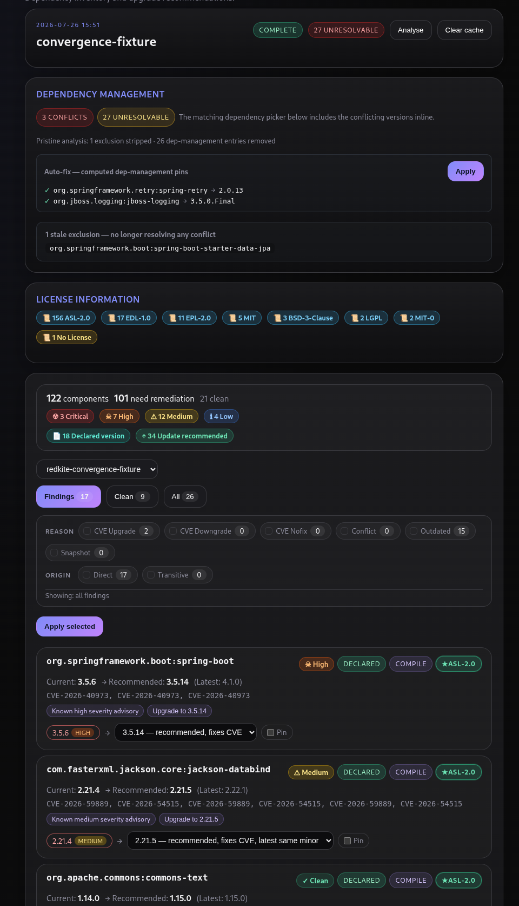

# RedKite

RedKite is a local Maven dependency analyser and upgrade assistant.

It analyses Maven projects, including multi-module builds, builds a dependency inventory, checks Maven Central for newer versions, records vulnerability findings from OSV.dev, and lets you select upgrades in the browser and generate a ready-to-apply updated POM.

> **Built with AI.** RedKite's code, tests, and documentation were written by **Claude** (Anthropic) and **Codex** (OpenAI), directed, reviewed, and manually tested by the author. See [AI-Assisted Development](https://johnjoeallen.github.io/redkite/development/ai-assisted-development/).



📖 [Documentation](https://johnjoeallen.github.io/redkite/) — start with [Getting Started](https://johnjoeallen.github.io/redkite/getting-started/).

## What It Does

- analyses Maven projects, including multi-module builds (dependencies, dependency management, and build plugins)
- shows declared (direct) and transitive dependencies with scope and version source
- highlights SNAPSHOT dependencies as unverified risks
- fetches and caches version metadata from Maven Central
- fetches and caches vulnerability data from OSV.dev
- recommends upgrades grouped by module with per-component version selectors
- resolves known CVEs in three tiers — an upgrade that clears the vulnerability, a downgrade below where it was introduced if no upgrade fixes it, or a best-effort suggestion at the lowest achievable severity if neither fully resolves it — each verified live so the suggested version doesn't carry an unrelated CVE of its own
- applies selected upgrades directly to the POMs on disk, validating the build before and after
- keeps all data on the developer machine

## Requirements

- Java 25 or later ([download](https://adoptium.net))
- Maven 3.9+ (must be on `PATH` for dependency tree resolution)

## Install

Download the latest `red-kite-<version>.zip` from the [releases page](../../releases), then unzip it:

```bash
unzip red-kite-<version>.zip -d red-kite
cd red-kite
```

## Start The Server

```bash
./red-kite.sh
```

On Windows:

```bat
red-kite.bat
```

The server starts on port `6502` and stores its database in `~/.redkite/`. Open the UI at:

```
http://localhost:6502
```

## Analyse A Repository

On the home page, type the full path to a Maven project and click **Analyse**. A progress overlay shows while the analysis runs; the browser navigates to the analysis when complete.

You can also click the **Analyse** button next to any previously-analysed project on the home page, or **Analyse** from inside an existing analysis.

## Project Page

Each project has a page showing:

- a summary of the latest analysis (component count, recommendations, status)
- an **Analysis history** list of all past analyses with timestamps and status badges — click any row to open that analysis
- an **Analyse** button to trigger a new analysis
- the resolved `settings.xml` path and configured Maven repositories

## Apply Upgrades

In the analysis, adjust target versions in the dropdowns and click **Apply selected**. RedKite runs a bracketed validation sequence:

1. Builds the project in its current state (`mvn clean install -DskipTests`)
2. Writes all POM changes to disk
3. Builds again to confirm the changes produce a working build

A progress overlay shows the current phase. If post-apply validation fails, RedKite reverts all POM changes and reports the failure with the attributed dependency where possible. If the project was already failing before apply, that is noted and the revert logic still runs. Once apply succeeds, RedKite automatically triggers a fresh analysis of the project so you can see whether any further fixes are needed.

General upgrades stay property-backed: any literal `<version>` tag is normalized to a `${artifactId.version}` property reference, and RedKite updates the property value to the chosen version. Dependency-management is reserved for conflict fixes and transitive overrides, and those pins always use an explicit, hardcoded version number rather than a `${...}` property reference.

Apply conflict fixes (dependency-management pins and exclusions) before applying general upgrades. Conflicts pin a dependency to a specific resolved version across modules, so applying an unrelated upgrade first can shift what "resolved" means and invalidate the conflict fix, forcing you to re-check convergence after the fact.

Use **Clear cache** to flush the cached version and vulnerability metadata and force a fresh fetch on the next analysis.

## Maven Plugin

RedKite can also produce its report as part of a Maven build, without running the server. It prints to the build log, writes no files by default, never edits POMs and needs no change to the project it analyses.

The plugin is on Maven Central (`net.dublinux.redkite:red-kite-maven-plugin`), so Maven downloads it on first use. Run it in any project:

```bash
# in the project to analyse (root pom.xml directory)
mvn -B net.dublinux.redkite:red-kite-maven-plugin:0.99.207:report   # print the report, never fails the build
mvn -B net.dublinux.redkite:red-kite-maven-plugin:0.99.207:check    # fail the build for vulnerabilities that have a same-major fix
mvn -B net.dublinux.redkite:red-kite-maven-plugin:0.99.207:upgrade -Dredkite.upgrades=com.fasterxml.jackson.core:jackson-databind:2.22.3   # upgrade what you name
mvn -B net.dublinux.redkite:red-kite-maven-plugin:0.99.207:upgrade-cve    # upgrade only to fix vulnerabilities
mvn -B net.dublinux.redkite:red-kite-maven-plugin:0.99.207:upgrade-all    # CVE fixes plus recommended upgrades
mvn -B net.dublinux.redkite:red-kite-maven-plugin:0.99.207:drop -Dredkite.pins=com.rabbitmq:amqp-client      # remove a pin
mvn -B net.dublinux.redkite:red-kite-maven-plugin:0.99.207:unpin -Dredkite.pins=com.rabbitmq:amqp-client     # keep the version, release the pin
```

The report lists each vulnerable dependency once, with its advisories, the POMs that declare it (or the modules that pull it in), whether it is pinned, and a flag for POMs outside the build, which the upgrade goals cannot edit. Folders that are not part of the build, such as test fixtures that deliberately use old versions, can be left out of the analysis with the `excludes` setting:

```xml
<plugin>
  <groupId>net.dublinux.redkite</groupId>
  <artifactId>red-kite-maven-plugin</artifactId>
  <configuration>
    <excludes>
      <exclude>test/projects</exclude>
    </excludes>
  </configuration>
</plugin>
```

Or on the command line: `-Dredkite.excludes=test/projects,samples`.

> **Java version:** RedKite is built for Java 25 from 0.99.207, so it needs Java 25 or later. 0.99.206 and earlier plugin releases run on Java 17 or later.

To use the short `redkite:` prefix instead, add `<pluginGroup>net.dublinux.redkite</pluginGroup>` under `<pluginGroups>` in `~/.m2/settings.xml`, then run `mvn -B redkite:report` or `mvn -B redkite:check`.

Every option is a `-D` property on the command line or a `<configuration>` entry in the POM:

| Property | Default | Goals | Meaning |
|---|---|---|---|
| `redkite.skip` | `false` | both | Skip the plugin. |
| `redkite.excludes` | none | all | Comma-separated directories, relative to the project root, whose POMs are not analysed (for example test fixtures). In the POM: `<excludes><exclude>test/projects</exclude></excludes>`. |
| `redkite.consoleReport` | `true` | both | Print the text report to the build log. |
| `redkite.progress` | `true` | both | Show progress: a live spinner on a terminal, one log line per step when piped, in `-B`, on CI or with `-X`. |
| `redkite.allowMajorUpgrades` | `false` | both | Allow upgrade recommendations that cross a major version. |
| `redkite.showTransitives` | `false` | `report` | Also list plain "newer version exists" updates for transitive dependencies, in a separate section. Vulnerability fixes are always listed. |
| `redkite.enforcer` | `false` | both | Also run the dependency-convergence analysis (several extra Maven runs). |
| `redkite.jsonReport` | `false` | both | Also write a JSON copy of the report. No files are written by default. |
| `redkite.outputDirectory` | `${project.build.directory}/redkite` | both | Where the JSON report goes when `jsonReport` is true. |
| `redkite.cache` | `false`, or `true` when the `RK_CACHE` environment variable is `true` | both | Keep a persistent lookup cache between builds. Off means an in-memory database and nothing on disk. |
| `redkite.db.url` | `jdbc:h2:${user.home}/.redkite/plugin/redkite;MODE=PostgreSQL;DATABASE_TO_LOWER=TRUE;AUTO_SERVER=TRUE` | both | H2 database for the cache; used only when `redkite.cache` is true. |
| `redkite.failOnSeverity` | `HIGH` | `check` | Fail when a same-major fix exists for a vulnerability at or above this severity (`LOW`, `MEDIUM`, `HIGH`, `CRITICAL`; `NONE` disables). |
| `redkite.failOnSnapshot` | `false` | `check` | Fail on SNAPSHOT dependencies. |
| `redkite.failOnIncomplete` | `false` | `check` | Fail when metadata could not be fetched. |
| `redkite.upgrades` | none (required) | `upgrade` | Dependencies to upgrade: comma-separated `groupId:artifactId[:version]`. No version means RedKite's recommended one. A direct dependency is upgraded where declared; a transitive one is pinned in the root POM. |
| `redkite.pins` | none (required) | `drop`, `unpin` | Pins to remove: comma-separated `groupId:artifactId`. |
| `redkite.dryRun` | `false` | all edit goals | Show what would change and write nothing. |

**Cache on for local builds only.** The cache is off unless asked for, so CI needs no change. To turn it on just for your own machine, set an environment variable, with no POM or settings changes:

```bash
export RK_CACHE=true    # e.g. in ~/.bashrc
```

An explicit `-Dredkite.cache=true|false` or POM `<cache>` setting always wins over the variable. Where `RK_CACHE` is unset (CI), the cache stays off.

The [Maven plugin docs](https://johnjoeallen.github.io/redkite/reference/maven-plugin/) have a step-by-step runbook for enabling it in a project (suitable for a coding agent), how to bind it to a build profile, reading the output, every parameter, and troubleshooting.

## Configuration

Pass JVM system properties to override defaults, or set them persistently in `~/.redkite/redkite.properties` (created from a bundled default by `red-kite.sh`/`red-kite.bat` on first run — a `-D` flag always overrides the file):

```bash
java -Dredkite.port=8080 -jar red-kite.jar
```

| Property | Default |
|---|---|
| `redkite.port` | `6502` |
| `redkite.db.url` | `jdbc:h2:~/.redkite/redkite;MODE=PostgreSQL;DATABASE_TO_LOWER=TRUE` |
| `redkite.db.user` | `sa` |
| `redkite.db.password` | _(empty)_ |
| `redkite.prefs.file` | `~/.redkite/preferences.properties` |
| `redkite.osv.url` | `https://api.osv.dev` |
| `redkite.version.lookback` | `10` — how many older releases the version-selector dropdown offers below the current version |

### Build Validation Settings

Some projects need a Spring profile or other environment-specific config to build or start (e.g. for the `spring-boot:run` startup check). These are per-project, not global, since different projects can need different values — declared in a `.redkite/settings.yml` file checked into the project itself (`.redkite/settings.yaml` also works, and takes precedence if both exist), not through RedKite's UI:

```yaml
redkite:
  maven:
    mode: [run, test]
    fullLogs: false
    profile: dev
    args:
      - "-Dfoo=bar"
    env:
      SPRING_PROFILES_ACTIVE: dev
      DB_HOST: localhost
    spring:
      profiles: dev,local
```

`args`/`profile`/`env` apply to every validation call; `spring.profiles` applies only to the `spring-boot:run` startup check. `mode` is a combination of `run`/`verify`/`test` (single value or list) — the deepest phase present picks the Maven goal (`run` → `install`, `verify` → `verify`, `test` alone → `test`) and whether a startup check is ever attempted (only when `run` is present); separately, `-DskipTests` is added unless `test` appears anywhere in the combination — so `mode: run` (default) skips tests as before, `mode: [run, test]` runs them during `install`, and `mode: verify` alone now also skips tests (write `mode: [verify, test]` for the traditional "verify with tests" behavior). `fullLogs` (default `false`) applies regardless of mode — set it to `true` to include dependency transfer logging in the raw build output, normally suppressed via `--no-transfer-progress`.

Picked up on the next apply — no restart needed. The project's own page shows a read-only panel with whatever the file currently resolves to. If a project has neither file yet, RedKite creates a commented-out `settings.yml` template automatically on its first scan.

### Config Page

The gear icon in the top nav opens `/config`, where the vulnerability and version metadata cache TTLs can be changed at runtime (stored in the database, seeded from the compiled-in defaults on first run) — presets from 15 minutes to 1 day. Changes apply to the next lookup; no restart needed.

## Build From Source

Requires Maven 3.9+ and Java 25.

```bash
mvn package -DskipTests
```

The fat JAR is produced at `red-kite-server/target/red-kite-<version>.jar`.

## Known Limitations

- Maven projects only.
- Local repositories only.
- No Gradle, npm, or Docker support.
